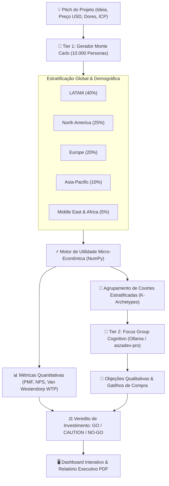

# 🌐 Market Twin • Simulador de População Sintética & Validação de PMF

Motor de simulação populacional e estocástica de mercado capaz de sintetizar **10.000 a 100.000 clones virtuais** em 5 macrorregiões globais (LATAM, América do Norte, Europa, Ásia-Pacífico e Oriente Médio/África) para validação empírica de propostas de produtos, startups e softwares.

---

## 🏛️ Arquitetura em Dois Níveis (Dual-Tier Cognitive Engine)

O Market Twin resolve o gargalo de custo e latência de inferência combinando micro-econometria vetorial de alto desempenho (Monte Carlo) com grupos focais qualitativos profundos orquestrados via SLM/LLM local (`aszadev-pro` / Ollama).



---

## 🚀 Capacidades Principais

1. **Geração Vetorizada de 10.000 Clones em Sub-Segundos:**
   - Distribuição de renda calibrada por paridade do poder de compra (PPP / PIB per capita regional).
   - Níveis de ceticismo, sensibilidade a preço e maturidade técnica modelados por distribuições Beta e Log-Normal com sementes determinísticas.
2. **Índice de Product-Market Fit (PMF Index 0-100):**
   - Baseado na fórmula de Sean Ellis ("Como você se sentiria se não pudesse mais usar este produto?"), taxa de adoção e elasticidade.
3. **Curva de Elasticidade e Sensibilidade de Preço (Van Westendorp PSM):**
   - Identifica o Ponto de Preço Ótimo (OPP) e Faixa de Preço Aceitável em dólares.
4. **Focus Group Sintético com SLM Local:**
   - Extração de feedbacks reais com verbatims, objeções severas e gatilhos de decisão por arquétipo regional.
5. **Veredito Executivo de Investimento:**
   - Classificação objetiva: `FORTE RECOMENDAÇÃO (GO)`, `GO CONDICIONAL`, `ALTO RISCO (CAUTION)` ou `NÃO INVESTIR (NO-GO)`.
6. **Exportação Executiva em PDF:**
   - Dossiê para investidores, sócios e fundadores pronto para apresentação.

---

## 🛠️ Stack Tecnológica

- **Linguagem & Runtime:** Python 3.12+ gerenciado rigorosamente via `uv`.
- **Backend & Servidor:** FastAPI + Uvicorn + Pydantic v2.
- **Modelagem Estatística:** NumPy & Pandas (distribuições estocásticas vetorizadas).
- **Inteligência Artificial:** Ollama Local (`aszadev-pro:latest` / `aszadev-fast:latest` / `dolphin-mistral:latest`).
- **Geração de Relatórios:** ReportLab (PDFs executivos vetoriais).
- **Interface & CLI:** Tailwind CSS / Vanilla JS executivo e Rich CLI no terminal.

---

## 💻 Instalação e Execução

### 1. Sincronizar Dependências com `uv`
```bash
uv sync
```

### 2. Executar via Terminal (CLI)
```bash
# Simulação rápida com 10.000 clones virtuais
uv run -m market_twin.cli run --pitch "API de Monitoramento de Pagamentos PIX em Tempo Real" --price 49 --population 10000
```

### 3. Iniciar Servidor e Dashboard Web
```bash
uv run -m market_twin.server
# Acesse no navegador: http://127.0.0.1:8090
```

---

## 📄 Licença
Propriedade de Alex Souza • Consultoria Inteligente. Todos os direitos reservados.
